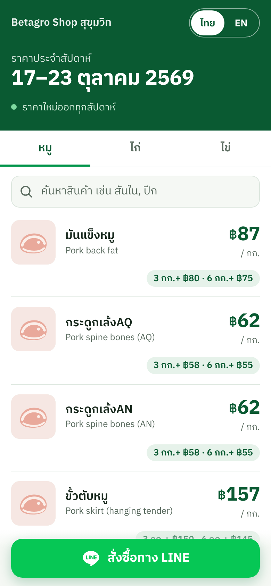
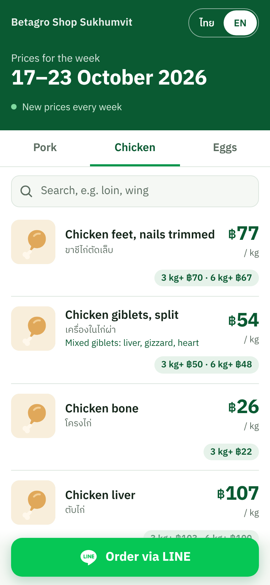

# Betagro Shop price menu (QR)

A one-page price list for Betagro Shop Sukhumvit's B2B team. The salesperson shows a QR code,
the café / bar / school owner scans it, and sees our pork, chicken, egg (and later fish) prices
for this week, with quantity discounts, in Thai or English, with a button to order on LINE.

เมนูราคาหน้าเดียวสำหรับทีมขาย B2B ของ Betagro Shop สุขุมวิท พนักงานขายโชว์ QR ลูกค้าสแกนแล้วเห็นราคาหมู ไก่ ไข่ ปลา
ของสัปดาห์นี้ เป็นภาษาไทยหรืออังกฤษ พร้อมปุ่มสั่งซื้อทาง LINE

| Phone view (TH) | Phone view (EN) |
|---|---|
|  |  |

More in [`docs/screens/`](docs/screens/) (pork, chicken, eggs × TH/EN). A category with no products is hidden.

## Weekly flow / ขั้นตอนทุกสัปดาห์

The sheet covers one week, Saturday to Friday (e.g. 17/10/2026 – 23/10/2026), with prices for
1-2 kg, 3 kg+, 6 kg+ and 10 kg+ (eggs: per tray of 30).
ใบราคาใช้ได้หนึ่งสัปดาห์ เสาร์ถึงศุกร์ มีราคาตามจำนวน 1-2 กก. / 3 กก.ขึ้นไป / 6 กก.ขึ้นไป / 10 กก.ขึ้นไป

1. **Get the sheet / รับไฟล์ราคา** — Save the new price PDF or image (e.g. `BTG-price-2026-10-24.pdf`).
   บันทึกไฟล์ PDF หรือรูปราคาใหม่
2. **Extract / ดึงราคา** — Give the file to the extractor (Claude now, Benny later). It returns
   one JSON file that follows [`EXTRACTOR_CONTRACT.md`](EXTRACTOR_CONTRACT.md).
   ส่งไฟล์ให้ตัวดึงราคา (ตอนนี้ Claude ต่อไป Benny) จะได้ไฟล์ JSON หนึ่งไฟล์
3. **Publish / เผยแพร่** — `node scripts/publish-prices.mjs incoming.json`
   Read every `WARN` line (big price jumps, prices that rise with quantity, outliers, duplicate SAP codes, missing items). If it says `Rejected`, nothing changed; fix and rerun.
   อ่านทุกบรรทัด `WARN` (ราคาขึ้นลงมาก สินค้าขาด) ถ้าขึ้นว่า `Rejected` แปลว่ายังไม่มีอะไรเปลี่ยน ให้แก้แล้วรันใหม่
4. **Go live / ขึ้นเว็บ** — `git add data/prices && git commit -m "prices 2026-10-24" && git push`.
   GitHub Pages updates in about a minute. The QR code never changes.
   หน้าเว็บอัปเดตภายในประมาณ 1 นาที QR เดิมใช้ได้ตลอด

`publish-prices.mjs` is the only way prices get into the site. Never edit `data/prices/*.json` by hand.
ราคาเข้าเว็บได้ทางเดียวคือ `publish-prices.mjs` ห้ามแก้ไฟล์ราคาด้วยมือ

## What lives where

| Path | What |
|---|---|
| `index.html`, `app.js`, `styles.css` | The menu page. No framework, no build. |
| `config.json` | Shop name and LINE OA link. **Replace `line_oa_url` before go-live.** |
| `data/catalog.json` | Products (our SKU, Betagro SAP code, Thai/English names and descriptions, unit, photo). Edit by hand when the range changes. |
| `data/prices/YYYY-MM-DD.json` | One file per price week (history), named by `valid_from`. Each product has quantity tiers. |
| `data/prices/latest.json` | Copy of the newest week. The page reads this. |
| `schema/` | JSON Schemas for catalog and prices. |
| `scripts/validate.mjs` | Checks everything. Runs in CI on every push. |
| `scripts/publish-prices.mjs` | Checks an extractor's JSON and publishes it. |
| `scripts/make-qr.mjs` | Makes the QR code PNG. |
| `assets/products/` | Product images. Seed images are placeholders. |

## Setup

```bash
npm install                 # only needed for the QR script
npm run validate            # check data
npm run serve               # open http://localhost:8000
```

**GitHub Pages:** Settings → Pages → Deploy from branch → `main` / root. Works under
`https://<user>.github.io/<repo>/` because all paths are relative.

**QR code:** `node scripts/make-qr.mjs https://<user>.github.io/<repo>/ docs/qr/menu-qr.png`
Add `?lang=en` to the URL for a QR that always opens in English. Otherwise the page follows the phone's language.

## Before go-live

- [x] Replace the placeholder products with the real sheet (2026-10-22: 33 pork, 26 chicken, 6 eggs).
- [ ] Confirm SAP code 1000053261 with Betagro (listed twice on the sheet: ไก่NY (ไก่ล้วง) and ไก่ล้วง).
- [ ] Add fish products to the catalog when they appear on a sheet (the fish tab stays hidden until then).
- [ ] Add real product photos to `assets/products/` (square, ~256 px, under 30 KB each). Today every product uses its category's placeholder SVG.
- [ ] Set the real LINE OA link in `config.json`.
- [ ] Publish the first real week of prices.

See also: [`CODING_STANDARDS.md`](CODING_STANDARDS.md).
