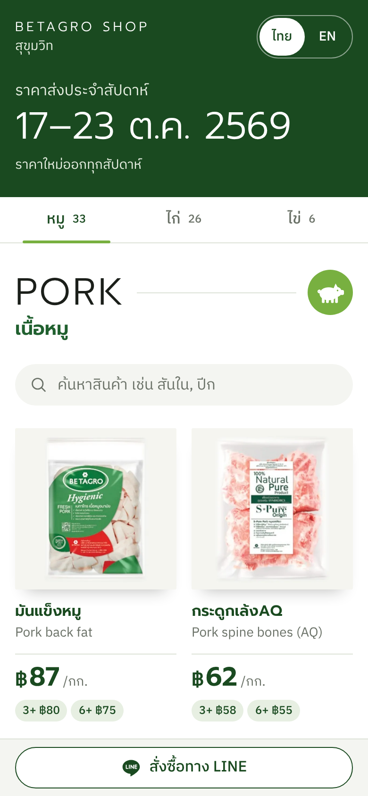
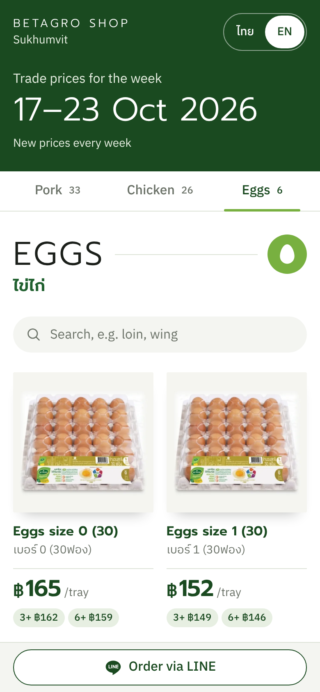
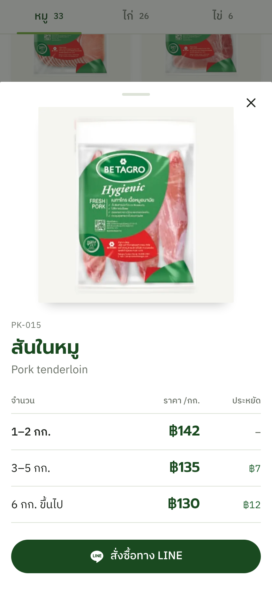
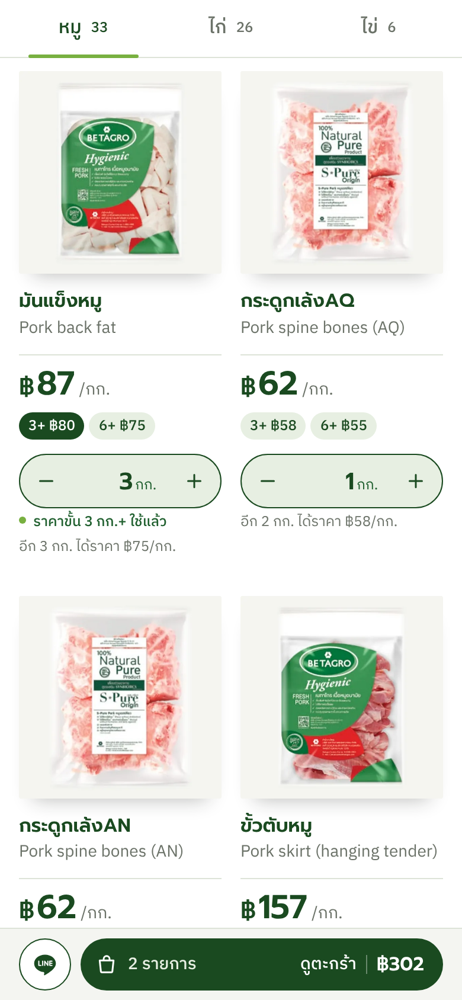
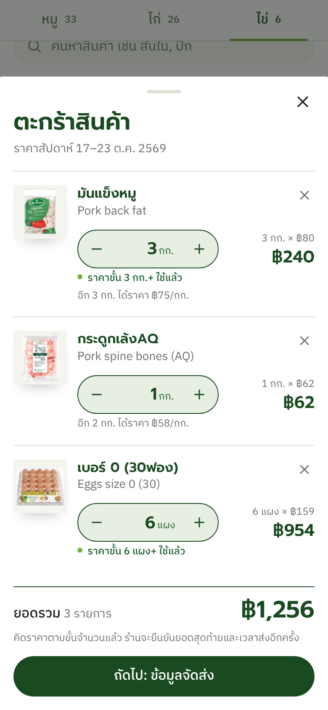
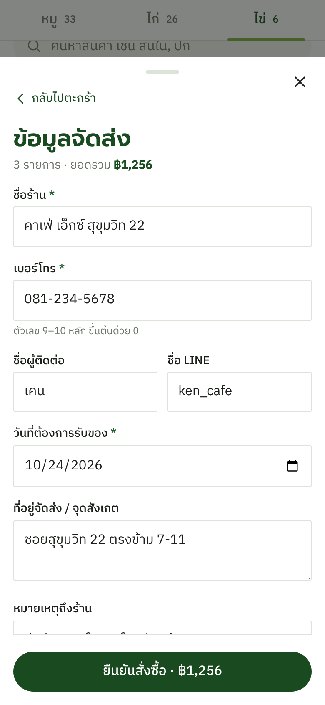
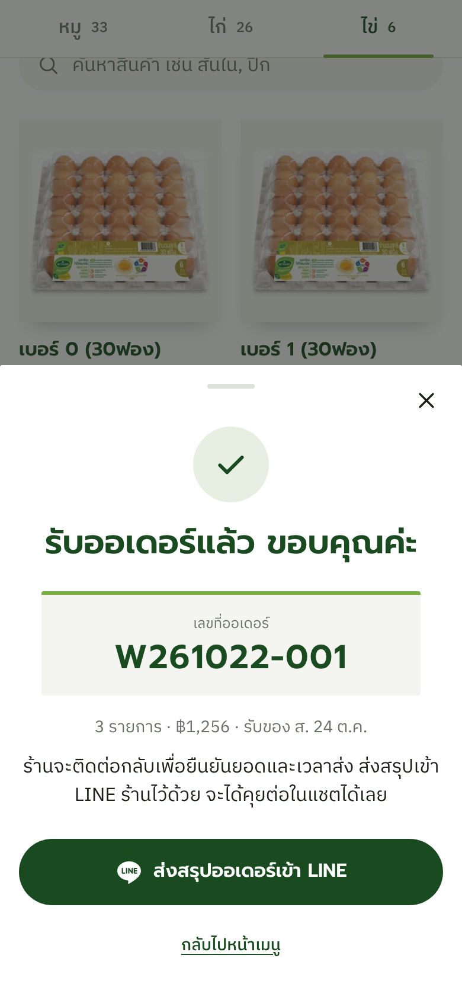

# Betagro Shop price menu (QR)

A one-page price list for Betagro Shop Sukhumvit's B2B team. The salesperson shows a QR code,
the café / bar / school owner scans it, and sees our pork, chicken, egg (and later fish) prices
for this week, with quantity discounts, in Thai or English, with a button to order on LINE.

เมนูราคาหน้าเดียวสำหรับทีมขาย B2B ของ Betagro Shop สุขุมวิท พนักงานขายโชว์ QR ลูกค้าสแกนแล้วเห็นราคาหมู ไก่ ไข่ ปลา
ของสัปดาห์นี้ เป็นภาษาไทยหรืออังกฤษ พร้อมปุ่มสั่งซื้อทาง LINE

| Phone view (TH) | Phone view (EN) | Product sheet |
|---|---|---|
|  |  |  |

More in [`docs/screens/`](docs/screens/) (`v2-*` = current design, `menu-*` = v1). A category with no products is hidden.

## Weekly flow / ขั้นตอนทุกสัปดาห์

The sheet covers one week, Saturday to Friday (e.g. 17/10/2026 – 23/10/2026), with prices for
1-2 kg, 3 kg+, 6 kg+ and 10 kg+ (eggs: per tray of 30).
ใบราคาใช้ได้หนึ่งสัปดาห์ เสาร์ถึงศุกร์ มีราคาตามจำนวน 1-2 กก. / 3 กก.ขึ้นไป / 6 กก.ขึ้นไป / 10 กก.ขึ้นไป

1. **Get the sheet / รับไฟล์ราคา** — Save the new price PDF or image (e.g. `BTG-price-2026-10-24.pdf`).
   บันทึกไฟล์ PDF หรือรูปราคาใหม่
2. **Extract / ดึงราคา** — Give the file to the extractor (Claude now, Benny later). It returns
   one JSON file that follows [`EXTRACTOR_CONTRACT.md`](EXTRACTOR_CONTRACT.md).
   ส่งไฟล์ให้ตัวดึงราคา (ตอนนี้ Claude ต่อไป Benny) จะได้ไฟล์ JSON หนึ่งไฟล์
3. **Publish / เผยแพร่** — `node scripts/publish-prices.mjs incoming.json`
   Read every `WARN` line (big price jumps, prices that rise with quantity, outliers, duplicate SAP codes, missing items). If it says `Rejected`, nothing changed; fix and rerun.
   อ่านทุกบรรทัด `WARN` (ราคาขึ้นลงมาก สินค้าขาด) ถ้าขึ้นว่า `Rejected` แปลว่ายังไม่มีอะไรเปลี่ยน ให้แก้แล้วรันใหม่
4. **Go live / ขึ้นเว็บ** — `git add data/prices && git commit -m "prices 2026-10-24" && git push`.
   GitHub Pages updates in about a minute. The QR code never changes.
   หน้าเว็บอัปเดตภายในประมาณ 1 นาที QR เดิมใช้ได้ตลอด

`publish-prices.mjs` is the only way prices get into the site. Never edit `data/prices/*.json` by hand.
ราคาเข้าเว็บได้ทางเดียวคือ `publish-prices.mjs` ห้ามแก้ไฟล์ราคาด้วยมือ

## Online ordering / สั่งซื้อออนไลน์

| Tile | Cart | Details | Done |
|---|---|---|---|
|  |  |  |  |

1. The buyer taps **ใส่ตะกร้า / Add** on a tile or in the product sheet and sets a whole-number quantity.
   The unit price is the tier for that quantity from `latest.json` (1–2 / 3+ / 6+ / 10+), and the page says
   when a cheaper tier is used and how much more unlocks the next one.
   ลูกค้ากดใส่ตะกร้าแล้วเลือกจำนวน ราคาต่อหน่วยคิดตามขั้นจำนวนจาก `latest.json` และบอกว่าซื้อเพิ่มอีกเท่าไรจะได้ราคาขั้นถัดไป
2. The cart bar opens the cart, then a short form (shop name, phone, delivery date from tomorrow, address, note).
   แถบตะกร้าด้านล่างเปิดตะกร้า แล้วกรอกข้อมูลจัดส่งสั้น ๆ (ชื่อร้าน เบอร์โทร วันรับของตั้งแต่พรุ่งนี้ ที่อยู่ หมายเหตุ)
3. If `config.json` → `order_endpoint` is set, the order is POSTed to that Google Apps Script web app exactly as
   [`docs/ORDER_CONTRACT.md`](docs/ORDER_CONTRACT.md) says, and the buyer sees the order number. If it is empty
   (pilot), nothing is sent.
   ถ้าตั้ง `order_endpoint` ไว้ ออเดอร์จะส่งไป Apps Script ตาม `docs/ORDER_CONTRACT.md` และลูกค้าเห็นเลขที่ออเดอร์ ถ้าเว้นว่าง (ช่วงทดลอง) จะไม่ส่งไปไหน
4. Either way the buyer gets a big **ส่งสรุปออเดอร์เข้า LINE / Send order to LINE** button that opens the shop's
   LINE OA (`line_oa_id`) with the order summary already typed. If the POST fails, this button is the fallback.
   ทุกกรณีจะมีปุ่มส่งสรุปออเดอร์เข้า LINE ร้าน (ข้อความพิมพ์ให้แล้ว) ถ้าส่งเข้าระบบไม่สำเร็จก็ใช้ปุ่มนี้แทนได้
5. Ordering pauses on its own when this week's prices are out of date (same rule as the stale-price notice).
   ถ้าราคาหมดอายุ ระบบปิดการสั่งออนไลน์เองจนกว่าราคาสัปดาห์ใหม่จะขึ้น

**Order data never goes into this repo.** The cart and the buyer's details stay in the buyer's own browser
(localStorage) until they submit; submitted orders go only to the Apps Script → the DIFOT sandbox Google Sheet.
The repo is public: never commit orders, customer lists, phone numbers or the Apps Script secrets.
**ข้อมูลออเดอร์ไม่เคยเข้า repo นี้** ตะกร้าและข้อมูลลูกค้าอยู่ในเบราว์เซอร์ของลูกค้าเองจนกดส่ง ออเดอร์ที่ส่งแล้วไปที่ Apps Script → Google Sheet (DIFOT sandbox) เท่านั้น
repo นี้เป็นสาธารณะ ห้าม commit ออเดอร์ รายชื่อลูกค้า เบอร์โทร หรือความลับของ Apps Script

## What lives where

| Path | What |
|---|---|
| `index.html`, `app.js`, `styles.css` | The menu page. No framework, no build. |
| `config.json` | Shop name, LINE OA link + id (`line_oa_url`, `line_oa_id`), `shop_id` for orders, `order_endpoint` (Apps Script URL; empty = pilot, LINE only), `stale_after_days`. |
| `data/catalog.json` | Products (our SKU, Betagro SAP code, Thai/English names and descriptions, unit, photo). Edit by hand when the range changes. |
| `data/prices/YYYY-MM-DD.json` | One file per price week (history), named by `valid_from`. Each product has quantity tiers. |
| `data/prices/latest.json` | Copy of the newest week. The page reads this. |
| `schema/` | JSON Schemas for catalog and prices. |
| `scripts/validate.mjs` | Checks everything. Runs in CI on every push. |
| `scripts/publish-prices.mjs` | Checks an extractor's JSON and publishes it. |
| `scripts/make-qr.mjs` | Makes the QR code PNG. |
| `assets/products/` | Product photos `<SKU>.webp` (600 px square), cut from the Betagro catalogue PDF and matched by Thai name; `photo_match` in the catalog says exact / close / similar. Placeholder SVGs are for new SKUs only — an active, priced product without a real photo fails `npm run validate`. |

## Setup

```bash
npm install                 # only needed for the QR script
npm run validate            # check data
npm run serve               # open http://localhost:8000
```

**GitHub Pages:** Settings → Pages → Deploy from branch → `main` / root. Works under
`https://<user>.github.io/<repo>/` because all paths are relative.

**QR code:** `node scripts/make-qr.mjs https://<user>.github.io/<repo>/ docs/qr/menu-qr.png`
Add `?lang=en` to the URL for a QR that always opens in English. Otherwise the page follows the phone's language.

## Before go-live

- [x] Replace the placeholder products with the real sheet (2026-10-22: 33 pork, 26 chicken, 6 eggs).
- [ ] Confirm SAP code 1000053261 with Betagro (listed twice on the sheet: ไก่NY (ไก่ล้วง) and ไก่ล้วง).
- [ ] Add fish products to the catalog when they appear on a sheet (the fish tab stays hidden until then).
- [x] Add real product photos to `assets/products/` (2026-10-22: all 65 products, cut from Betagro_Trade_MKT_.pdf; review the `similar` ones).
- [ ] Set the real LINE OA link in `config.json`.
- [ ] Publish the first real week of prices.

See also: [`CODING_STANDARDS.md`](CODING_STANDARDS.md).
